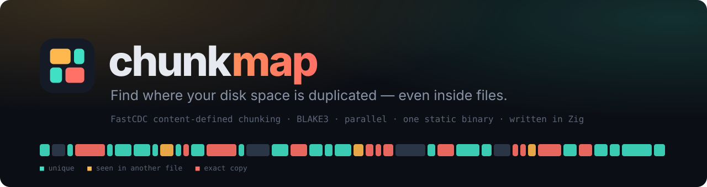
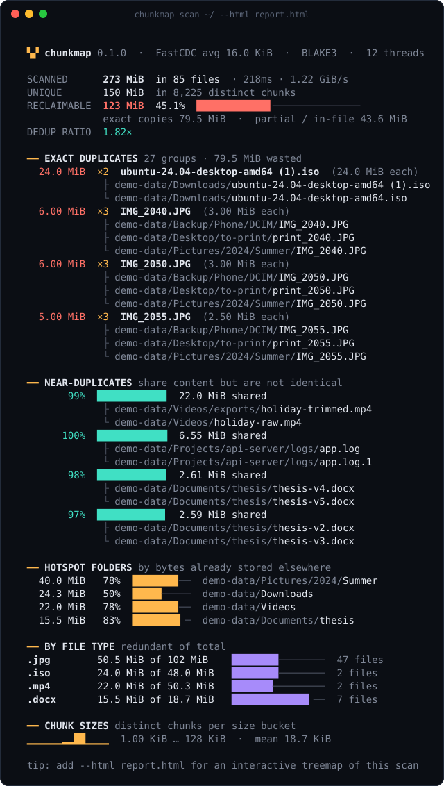
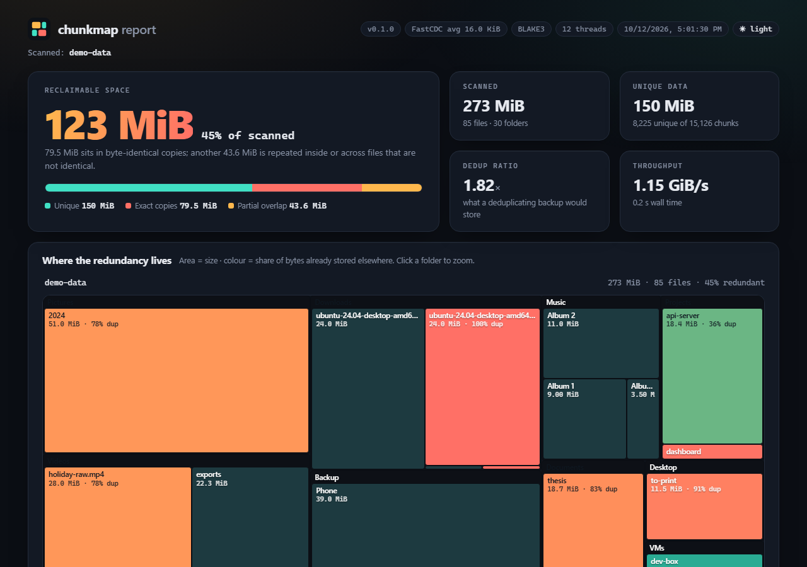
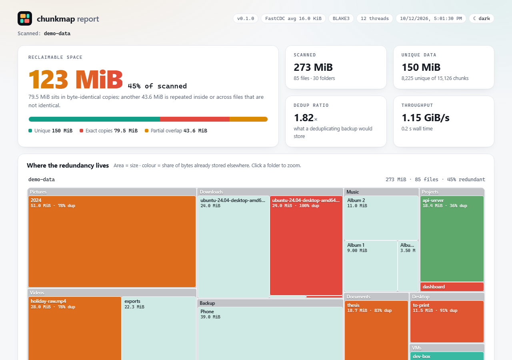
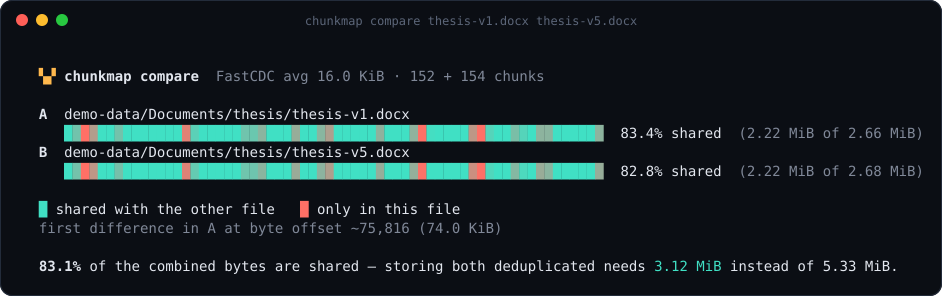
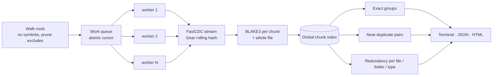

<p align="center">
  
</p>

<p align="center">
  <a href="https://github.com/ardazeybek-dev/chunkmap/actions/workflows/ci.yml"></a>
  <a href="https://github.com/ardazeybek-dev/chunkmap/releases"></a>
  
  
  
  <a href="LICENSE"></a>
</p>

<p align="center">
  <b><a href="https://ardazeybek-dev.github.io/chunkmap/">▶ Live example report</a></b> ·
  <a href="#install">Install</a> ·
  <a href="#usage">Usage</a> ·
  <a href="#how-it-works">How it works</a> ·
  <a href="#benchmarks">Benchmarks</a>
</p>

---

Your disk is full, and "find duplicate files" tools only catch **byte-identical** copies. Real disks are messier:

- `thesis-v3.docx`, `thesis-v4.docx`, `thesis-FINAL.docx` — 95 % the same bytes, different hashes
- a trimmed re-export of a 30 GB video that still contains 28 GB of the original
- `backup-monday.tar` vs `backup-tuesday.tar`, `app.log` vs `app.log.1`, VM images full of repeated blocks
- the same `node_modules` / `.venv` vendored into five projects

**chunkmap** cuts every file into *content-defined chunks* (the technique behind restic, borg and rsync-style dedup), fingerprints each chunk, and tells you exactly how much space is redundant — across files **and inside them** — and where it lives. It never modifies anything: it's a read-only X-ray of your disk.

```console
$ chunkmap scan ~/ --html report.html
```

<p align="center"></p>

## The interactive report

`--html report.html` writes **one self-contained file** (no network, no CDN, ~50 KB + your data) with a zoomable treemap coloured by redundancy, searchable duplicate groups with one-click path copying, near-duplicate pairs, folder/type breakdowns and the chunk-size distribution. Dark and light themes included.

<p align="center">
  <a href="https://ardazeybek-dev.github.io/chunkmap/"></a>
  <a href="https://ardazeybek-dev.github.io/chunkmap/"></a>
</p>

## Compare two files at chunk level

How different are two backups, really? `compare` streams both files (constant memory) and draws where they match:

```console
$ chunkmap compare thesis-v1.docx thesis-v5.docx
```

<p align="center"></p>

## Features

| | |
|---|---|
| 🧩 **Content-defined chunking** | FastCDC with a 64-bit Gear rolling hash and normalized chunking — an insertion only disturbs the chunks around it (verified by tests: >97 % of chunks survive a mid-file insert). |
| 🔐 **BLAKE3 fingerprints** | Per-chunk and whole-file digests computed in a single pass — every byte is read exactly once. |
| ⚡ **Parallel & streaming** | Lock-free work distribution over all cores; files are streamed through a fixed 1 MB buffer per worker — file contents are never loaded into memory. |
| 🎯 **Three kinds of redundancy** | Exact duplicate groups · near-duplicate pairs (containment + Jaccard) · repetition *inside* a single file. |
| 📊 **Three outputs** | Colour terminal summary · self-contained HTML treemap report · stable JSON for scripts and CI. |
| 🛡️ **Safe by design** | Read-only. Never follows symlinks (no cycles, no double counting). Unreadable files are reported, not fatal. |
| 📦 **Zero dependencies** | One static binary, cross-compiled for Linux, macOS and Windows on x86_64 and arm64. Only the Zig standard library. |

## Install

**Prebuilt binaries** — grab the archive for your platform from [Releases](https://github.com/ardazeybek-dev/chunkmap/releases), unpack, and put `chunkmap` on your `PATH`. Checksums are in `SHA256SUMS.txt`.

| Platform | Archive |
|---|---|
| Linux x86_64 / arm64 (static, musl) | `chunkmap-vX.Y.Z-x86_64-linux-musl.tar.gz` / `aarch64-linux-musl` |
| macOS Intel / Apple Silicon | `chunkmap-vX.Y.Z-x86_64-macos.tar.gz` / `aarch64-macos` |
| Windows x64 / ARM64 | `chunkmap-vX.Y.Z-x86_64-windows.zip` / `aarch64-windows` |

**From source** — requires [Zig 0.14.1](https://ziglang.org/download/):

```bash
git clone https://github.com/ardazeybek-dev/chunkmap
cd chunkmap
zig build -Doptimize=ReleaseFast        # → zig-out/bin/chunkmap
zig build test                          # unit tests
zig build release                       # cross-compile every platform → zig-out/<triple>/
```

## Usage

```text
chunkmap scan [PATH ...] [options]     Analyze one or more folders (default: .)
chunkmap compare <FILE_A> <FILE_B>     Show which parts of two files are shared
chunkmap help | version
```

```bash
# Your home folder, with an interactive report
chunkmap scan ~ --html report.html

# Several roots at once, skipping noise
chunkmap scan ~/Pictures ~/Downloads /mnt/backup -x .git -x node_modules -x '*.tmp'

# Only big files, coarser chunks (faster, less memory on multi-TB scans)
chunkmap scan /data --min-size 10M --avg-chunk 256K

# Machine-readable output for scripts / CI
chunkmap scan ./artifacts --json report.json -q
jq '.summary.reclaimable_bytes' report.json
```

| Option | Env variable | Default | Description |
|---|---|---|---|
| `-o, --html FILE` | `CHUNKMAP_HTML` | – | Write the interactive HTML report |
| `-J, --json FILE` | `CHUNKMAP_JSON` | – | Write the JSON report |
| `-x, --exclude GLOB` | `CHUNKMAP_EXCLUDE` (comma-separated) | – | Skip matching files/dirs; `*` and `?`, case-insensitive. Patterns with `/` match the root-relative path |
| `-m, --min-size SIZE` | `CHUNKMAP_MIN_FILE_SIZE` | `1` | Ignore smaller files |
| `-M, --max-size SIZE` | `CHUNKMAP_MAX_FILE_SIZE` | ∞ | Ignore larger files |
| `-a, --avg-chunk SIZE` | `CHUNKMAP_AVG_CHUNK` | `16K` | Average chunk size (power of two, 256 B – 4 MiB); min = avg/4, max = avg×8 |
| `-j, --threads N` | `CHUNKMAP_THREADS` | CPU count | Worker threads |
| `-s, --similarity F` | `CHUNKMAP_SIMILARITY` | `0.25` | Minimum overlap (0–1) to report a near-duplicate pair |
| `-n, --top N` | `CHUNKMAP_TOP` | `10` | Rows per terminal section |
| `--color MODE` | `CHUNKMAP_COLOR`, `NO_COLOR` | `auto` | `auto` · `always` · `never` |
| `--env-file FILE` | – | `.env` | Settings file to load |
| `-q, --quiet` | – | – | No progress output |

Sizes accept `B/K/M/G/T` suffixes (`512`, `16K`, `64KiB`, `1.5M`, `2G`).
Settings are resolved as **defaults → `.env` → environment → flags**; copy [`.env.example`](.env.example) to `.env` to keep your own defaults. Exit codes: `0` success, `1` runtime error, `2` invalid usage.

## How it works



**1 — Content-defined chunking.** A Gear hash slides over the bytes: `fp = (fp << 1) + G[byte]`, where `G` is a table of 256 random 64-bit values. A chunk ends wherever the top bits of `fp` are all zero. Since `fp` only depends on the last ~64 bytes, boundaries are anchored to *content*, not offsets — insert a paragraph into a document and only the chunk containing it changes, while fixed-size blocks would all shift and mismatch. FastCDC's *normalized chunking* uses a stricter mask before the target size and a looser one after it, which pulls chunk sizes tightly around the average (see the histogram in the report).

**2 — Fingerprinting.** Each chunk gets a 128-bit truncated BLAKE3 digest; the whole file is hashed in the same pass. Workers grab files from an atomic counter, so a single huge file never blocks the queue.

**3 — Attribution.** Walking files in path order, the first occurrence of a chunk is *unique*; every later occurrence is *redundant* and charged to the file where it appears. The sum of redundant bytes is exactly what a deduplicating store (restic, borg, ZFS dedup…) would save — the "reclaimable" figure.

**4 — Pairing.** Near-duplicates come from an inverted index *chunk → files*. Chunks present in very many files (e.g. runs of zeros) are skipped so pairing stays linear. A pair is reported when the shared bytes cover at least `--similarity` of the smaller file (*containment*); the combined-overlap *Jaccard* score is reported too.

## Benchmarks

Measured with a ReleaseFast build on a 12-thread Windows 11 laptop, warm file cache:

| Data set | Files | Size | Time | Throughput | Reclaimable |
|---|---:|---:|---:|---:|---:|
| Synthetic messy home folder (`scripts/make_demo_data.py`) | 85 | 273 MiB | 0.22 s | 1.2 GiB/s | 45 % |
| Real projects folder with Python virtualenvs | 37,119 | 2.90 GiB | 3.2 s | 921 MiB/s | 27 % |

Memory is dominated by chunk metadata: an estimated ~70 bytes per chunk (≈4–5 GB of RAM per TB scanned at the default 16 KiB average). Memory scales inversely with the chunk size, so use `--avg-chunk 64K` or larger for multi-terabyte scans.

## JSON report

`--json` emits a versioned document (`"schema": 1`) — handy for dashboards or CI checks such as *"fail if the build artifacts contain more than 100 MB of duplicates"*. Top-level keys:

`summary` · `params` · `scan` · `duplicate_groups` · `similar_pairs` · `directories` · `extensions` · `chunk_histogram` · `files` (largest 25,000; `files_omitted` / `bytes_omitted` cover the rest).

See [`docs/sample-report.json`](docs/sample-report.json) for a complete example.

## Project layout

```text
chunkmap/
├── build.zig               build, test and cross-compile (`zig build release`)
├── src/
│   ├── main.zig            entry point, scan orchestration, progress
│   ├── cli.zig             argument parsing and help text
│   ├── config.zig          defaults, .env parser, CHUNKMAP_* variables
│   ├── fastcdc.zig         Gear table, FastCDC chunker, streaming wrapper
│   ├── scanner.zig         filesystem walker, excludes, size filters
│   ├── pipeline.zig        parallel chunk + BLAKE3 hashing workers
│   ├── analysis.zig        chunk index, duplicate groups, pairs, rollups
│   ├── compare.zig         chunk-level two-file comparison
│   ├── glob.zig · format.zig · term.zig
│   └── report/
│       ├── model.zig       serializable report model (JSON schema)
│       ├── writers.zig     JSON + HTML writers
│       ├── terminal.zig    colour terminal report
│       └── template.html   self-contained interactive report (vanilla JS)
├── scripts/
│   ├── make_demo_data.py   reproducible messy-disk generator
│   ├── e2e.py              end-to-end test used in CI
│   └── ansi_to_svg.py      renders terminal output to SVG for docs
├── docs/                   GitHub Pages: live example report + images
└── .github/workflows/      CI (3 OSes), release (6 targets), Pages
```

## Pitfalls

- **Scan looks slow on Windows** → on-access antivirus scans every file chunkmap opens → exclude build/cache folders (`-x node_modules -x target`) or add the scanned folder to your AV exclusions.
- **"Reclaimable" ≠ what deleting duplicates frees** → it counts partial overlap too, which only a deduplicating filesystem/backup tool can reclaim → for plain deletion, look at the *exact copies* figure.
- **Near-duplicate list is empty for compressed formats** (`.zip`, `.mp4`, `.jpg` re-encodes) → compression scrambles bytes after the first change → compare the uncompressed sources instead.
- **Zig build fails with odd cache/path errors on Windows** → non-ASCII characters in the project path → set `ZIG_GLOBAL_CACHE_DIR` and `ZIG_LOCAL_CACHE_DIR` to an ASCII path.

## Contributing

Issues and pull requests are welcome — see [CONTRIBUTING.md](CONTRIBUTING.md). Run `zig fmt src build.zig`, `zig build test` and `python scripts/e2e.py zig-out/bin/chunkmap` before opening a PR.

## References

- W. Xia et al., *FastCDC: a Fast and Efficient Content-Defined Chunking Approach for Data Deduplication*, USENIX ATC 2016
- J. O'Connor et al., *BLAKE3 — one function, fast everywhere*, 2020
- M. Bruls, K. Huizing, J. van Wijk, *Squarified Treemaps*, 2000

## License

[MIT](LICENSE) © 2026 Arda Zeybek
